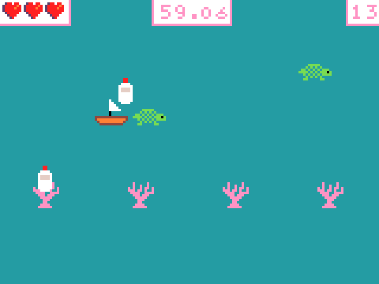

# Tide Turners

A small MakeCode Arcade game for 52685 Creative Coding (Assessment 2).
You have 90 seconds to clean a reef. Drive the boat, pick up rubbish, and don't hit the turtles or the coral.

## How to play it

**Option 1 — in the browser (easiest)**
1. Go to <https://arcade.makecode.com>.
2. Click **Import**, then **Import URL**.
3. Paste the link of this repository and click **Go ahead!**
4. The game runs in the simulator on the left.

**Option 2 — from the files**
Download `main.ts`, open a new MakeCode Arcade project, click **JavaScript**, paste everything in, then click **Blocks**.

**Controls:** arrow keys move the boat (or the D-pad in the simulator).

## Rules

- Each piece of rubbish = 1 point. Rubbish disappears after 7 seconds if nobody picks it up.
- The water starts brown. At 10 points it turns green-blue, at 20 it turns light blue.
- Hitting a turtle or coral = lose 1 life, and the boat goes back to the start. 3 lives.
- Time up = you win. No lives left = you lose.

## Files

| File / folder | What it is |
|---|---|
| `main.blocks` | My blocks (this is what I worked in) |
| `main.ts` | The same program in the JavaScript view |
| `pxt.json` | MakeCode project settings |
| `screenshots/` | Screenshots of the game and of the main blocks |
| `versions/week07_boat_moves/` | Week 7: only the boat moves |
| `versions/week08_rubbish_and_timer/` | Week 8: rubbish, score and timer (the version I showed in class) |
| `versions/week09_hazards_bug/` | Week 9: turtles, coral and lives, with the bug where one touch takes all 3 lives |

Each version folder has its own `main.ts` and `pxt.json`, so it can be opened the same way.

## How the code is organised

| Block / function | What it does |
|---|---|
| `on start` | Brown water, the list of 3 rubbish pictures, the boat, 4 coral (a `for` loop), score 0, 3 lives, 90 s countdown |
| `on game update every 1500 ms` | calls `spawnRubbish()` |
| `on game update every 4000 ms` | calls `spawnTurtle()` |
| `spawnRubbish()` | random picture from the list, random place, lifespan 7000 ms |
| `spawnTurtle()` | turtle starts on the left, speed 20–40, deleted when it leaves the screen |
| overlap Player–Rubbish | destroy the rubbish, +1 score, sound, `updateWater()` |
| overlap Player–Turtle / Player–Coral | −1 life, `sendBoatHome()` |
| `sendBoatHome()` | moves the boat back to (80, 108) and shakes the camera, so the overlap stops |
| `updateWater()` | if / else if / else on the score: brown, green-blue, light blue |
| `on countdown end` / `on life zero` | game over (win / lose) |

The main blocks and functions have comments (in the Blocks view, click the small speech-bubble icon on a block to read it).

## Credits

- Made with Microsoft MakeCode Arcade (Microsoft, n.d.-d).
- The overlap idea comes from the **Chase the Pizza** tutorial (Microsoft, n.d.-a). The comment on that block says so.
- `lifespan` and `on overlap` from the MakeCode reference pages (Microsoft, n.d.-b, n.d.-c).
- All sprites (boat, bottle, bag, can, turtle, coral) were drawn by me in the MakeCode sprite editor.
- Thanks to the three classmates who tested it in Week 10.

### References

Microsoft. (n.d.-a). *Chase the pizza* [Tutorial]. Microsoft MakeCode Arcade. Retrieved October 23, 2026, from https://arcade.makecode.com/tutorials/chase-the-pizza

Microsoft. (n.d.-b). *on overlap* [Reference documentation]. Microsoft MakeCode Arcade. Retrieved October 23, 2026, from https://arcade.makecode.com/reference/sprites/on-overlap

Microsoft. (n.d.-c). *lifespan (property)* [Reference documentation]. Microsoft MakeCode Arcade. Retrieved October 23, 2026, from https://arcade.makecode.com/reference/sprites/sprite/lifespan

Microsoft. (n.d.-d). *Microsoft MakeCode Arcade* [Computer software]. https://arcade.makecode.com/
